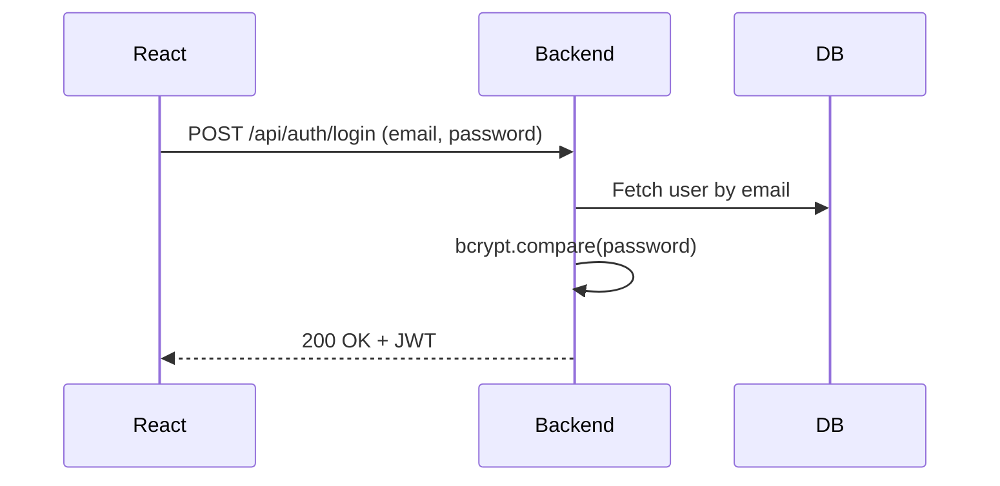
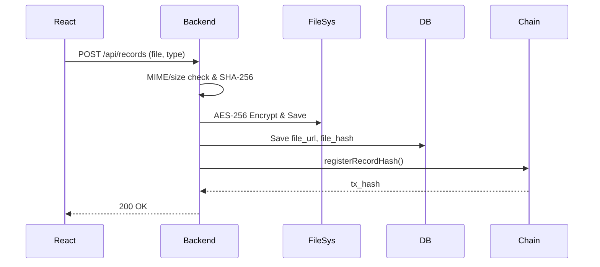
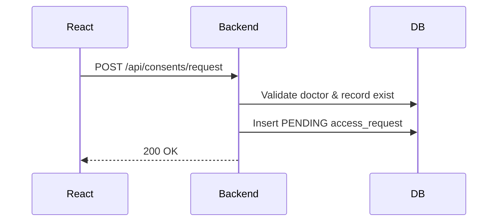
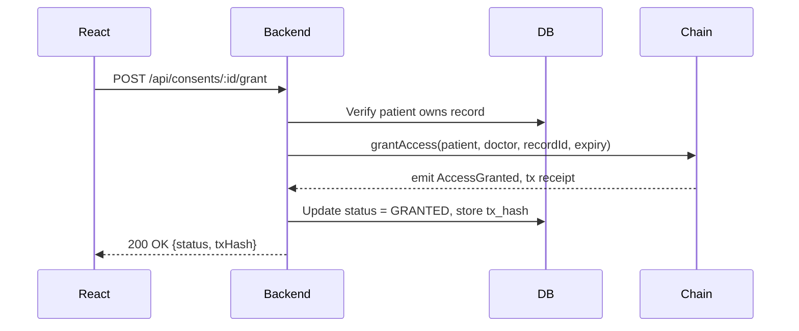
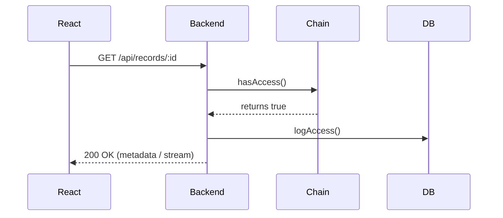
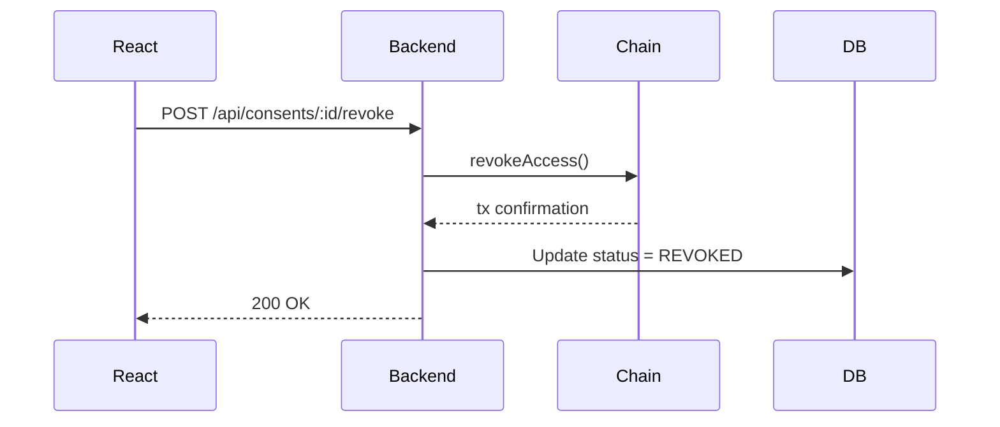
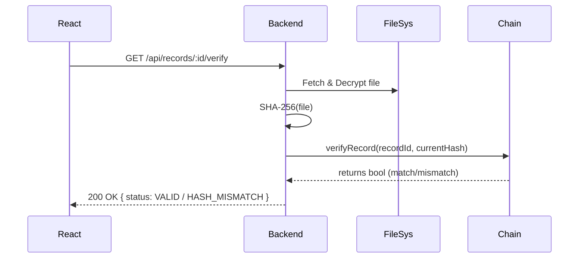
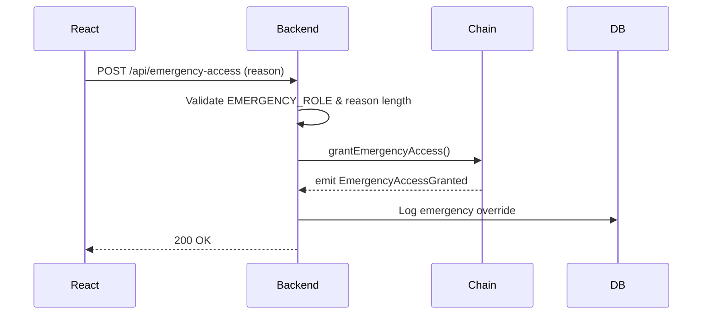

# HealthChain REST API Specification

## 1. API Architecture

* **Structure**: REST API utilizing JSON Web Tokens (JWT) for authentication.

* **Base URL**: `/api` (e.g., `http://localhost:5000/api`).

* **Request/Response Flow**: React Frontend → Express Route → `auth.js` Middleware → `roleCheck.js` Middleware → Express Controller → Service Layer → PostgreSQL Models / `blockchainService.js`.

* **Design Rule**: Controllers must never communicate directly with `ethers.js` or the database; all logic must pass through the service layer.

## 2. Authentication

* **Registration**: Passwords must be hashed using `bcrypt` (12 rounds) before storage.

* **Login**: Validates credentials via `bcrypt.compare` and issues a JWT.

* **JWT Payload**: `{ sub: userId, role, iat, exp }`.

* **Token Expiry**: Access token expires in 1 hour.

* **Refresh Token**: 7-day expiry, stored as an `httpOnly` cookie.

* **Authentication Errors**: Invalid credentials or missing tokens should return standard HTTP 401 Unauthorized responses (Specific JSON error schema is Not specified in the source blueprint).

## 3. All API Endpoints

| Method | Endpoint | Allowed Role | Auth | Purpose |
| --- | --- | --- | --- | --- |
| POST | `/api/auth/register` | Any | No | Create user account.

 |
| POST | `/api/auth/login` | Any | No | Authenticate user and issue JWT.

 |
| GET | `/api/patients/profile` | PATIENT | Yes | Retrieve own patient profile.

 |
| GET | `/api/patients/records` | PATIENT | Yes | List all records owned by the patient.

 |
| POST | `/api/records` | PATIENT, DOCTOR, LAB | Yes | Upload a new medical record.

 |
| GET | `/api/records/:id` | Consent-checked | Yes | View record metadata.

 |
| GET | `/api/records/:id/download` | Consent-checked | Yes | Stream decrypted medical file.

 |
| GET | `/api/records/:id/verify` | Consent-checked | Yes | Perform cryptographic hash verification.

 |
| POST | `/api/consents/request` | DOCTOR | Yes | Request access to patient record(s).

 |
| POST | `/api/consents/:id/grant` | PATIENT (Owner) | Yes | Grant access on-chain.

 |
| POST | `/api/consents/:id/reject` | PATIENT (Owner) | Yes | Reject access request.

 |
| POST | `/api/consents/:id/revoke` | PATIENT (Owner) | Yes | Revoke active access on-chain.

 |
| GET | `/api/access-history` | PATIENT, DOCTOR | Yes | Retrieve audit log of views/grants.

 |
| POST | `/api/labs/reports` | LAB | Yes | Upload lab report against a patient.

 |
| POST | `/api/emergency-access` | DOCTOR (Emergency) | Yes | Logged override access.

 |
| GET | `/api/admin/users` | ADMIN | Yes | System user management.

 |
| GET | `/api/admin/audit` | ADMIN | Yes | Retrieve full system audit logs.

 |

## 4. Medical Record APIs

* **Upload (`POST /api/records`)**:
* Requires MIME validation via real sniffing, 10MB size limit, and filename sanitization (stored under UUID).

* Generates a SHA-256 hash of the plaintext file.

* Encrypts the file via AES-256-GCM before saving to local disk.

* Calls `blockchainService.registerRecordHash`.

* **Download (`GET /api/records/:id/download`)**:
* Requires server-side consent validation (DB fast-path + on-chain `hasAccess()` confirmation).

* Decrypts the file and streams it; no public static URLs are permitted.

* **Verification (`GET /api/records/:id/verify`)**:
* Hashes the currently stored decrypted file and compares it to the on-chain hash via smart contract `verifyRecord()`.

* Returns `{ status: VALID | HASH_MISMATCH, hashes }`.

## 5. Consent APIs

* **Lifecycle**: PENDING (Request) → GRANTED or REJECTED → REVOKED or EXPIRED.

* **Scope**: Supports record-specific consent or whole-patient consent utilizing `recordId = 0/null`.

* **Database vs Blockchain**:
* Requests (`POST /api/consents/request`) create a DB row with `PENDING` status; this is an off-chain action.

* Grants (`POST /api/consents/:id/grant`) trigger an on-chain transaction. Once mined, the DB status updates to `GRANTED` with the transaction hash.

* Revocations (`POST /api/consents/:id/revoke`) trigger an on-chain transaction. Once executed, `hasAccess()` returns false immediately, overriding any stale DB row.

## 6. Role-Based Authorization

* **PATIENT**: Can access their own profile, records, consent requests, and access history. Cannot view other patients' data.

* **DOCTOR**: Can access assigned patients, request access, upload diagnoses, and view authorized records. Cannot view records without valid consent.

* **HOSPITAL**: Can manage affiliated doctors and view institutional audit logs.

* **LAB**: Can upload reports against patients.

* **ADMIN**: Can manage users and view full system-wide audit logs.

* **Errors**: Missing tokens return 401 Unauthorized; invalid roles/consent return 403 Forbidden (Custom error response format is Not specified in the source blueprint).

## 7. Blockchain Integration

* The API integrates with the blockchain exclusively through `blockchainService.js`.

* **Operations calling blockchainService.js**:
* `POST /api/records` → `registerRecordHash(recordId, hash, patientAddr)`.

* `POST /api/consents/:id/grant` → `grantAccess(patient, doctor, recordId, expiry)`.

* `POST /api/consents/:id/revoke` → `revokeAccess(patient, doctor, recordId)`.

* `GET /api/records/:id` (and download) → `hasAccess(patient, doctor, recordId)`.

* `GET /api/records/:id/verify` → `verifyRecord(recordId, currentHash)`.

* `POST /api/emergency-access` → `grantEmergencyAccess(patient, doctor, reason)`.

* **Flow Example**: Express Controller → Service Layer → `blockchainService.js` → `ethers.js` → Smart Contract.

* **Tx Hash Handling**: The backend waits for transaction confirmation (`await tx.wait()`) and stores the resulting hash in `blockchain_transactions` and the related consent/record row.

## 8. Validation & Error Handling

* **Input Validation**: Enforced via Joi/Zod.

* **File Validation**: Enforced via Multer, requiring real MIME sniffing and file size checks.

* **Blockchain Reverts**: Must be wrapped in try/catch blocks; the backend parses the revert reason and returns a clean 4xx HTTP error instead of a raw ethers stack trace.

* **Standard API Error Response Format**: Not specified in the source blueprint.

## 9. API Security

* **Authentication**: JWT and bcrypt.

* **Authorization**: RBAC enforced via `roleCheck.js` middleware, plus controller-level record authorization.

* **Data Protection**: AES-256-GCM encryption for stored files, parameterized ORM queries to prevent SQL injection, and environment secrets management (`.env`).

* **Network**: Restricted CORS to frontend origin, rate limiting on auth routes.

* **Privacy**: Strict rule of no Protected Health Information (PHI) stored on the blockchain or in audit logs.

## 10. API Flow Diagrams

### Login

### Record Upload

### Doctor Access Request

### Patient Grant

### Record Access

### Consent Revoke

### Record Verification

### Emergency Access

## 11. Frontend Integration

* **Axios Configuration**: The React frontend must configure an Axios instance (`services/api.js`) to attach the JWT as a Bearer token in the `Authorization` header for all requests except login/register.

* **State Management**: Context providers (`AuthContext`) manage the decoded token payload (`req.user.role`) to conditionally render role-specific layouts and navigation.

* **Direct Blockchain Communication**: The frontend must never communicate directly with the blockchain or prompt MetaMask; all blockchain interactions are routed via backend APIs.

## 12. API Implementation Checklist

* [ ] `auth.js` middleware implemented to verify JWTs.
* [ ] `roleCheck.js` middleware implemented for RBAC.
* [ ] `blockchainService.js` created and exclusively manages `ethers.js` calls.
* [ ] File upload pipeline validates MIME, size, sanitizes filename, hashes, encrypts, and saves.
* [ ] Patient endpoints implemented (`/api/patients/*`).
* [ ] Record endpoints implemented, including server-side `hasAccess` validation on read/download.
* [ ] Consent request, grant, and revoke endpoints correctly map to DB and chain state.
* [ ] Verify endpoint recalculates hash from decrypted file and queries smart contract.
* [ ] Audit and Emergency endpoints implemented and heavily logged.
* [ ] Global error handler catches blockchain reverts and translates them to HTTP 4xx.
